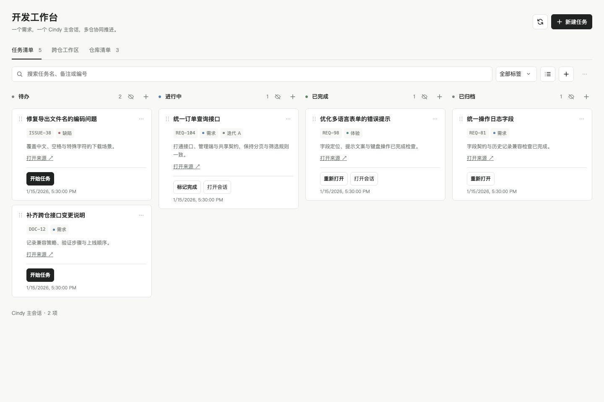
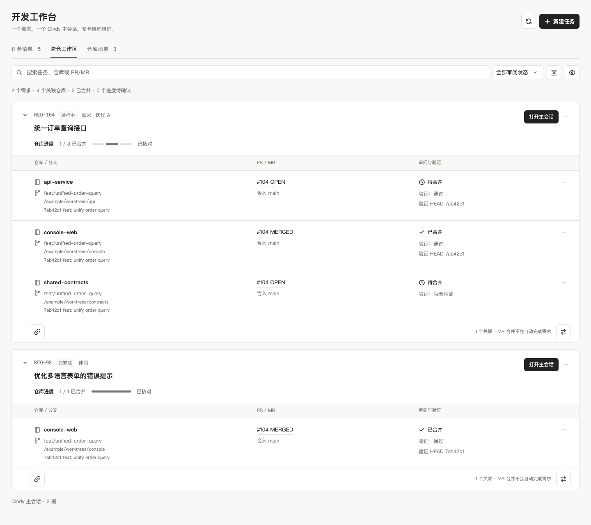
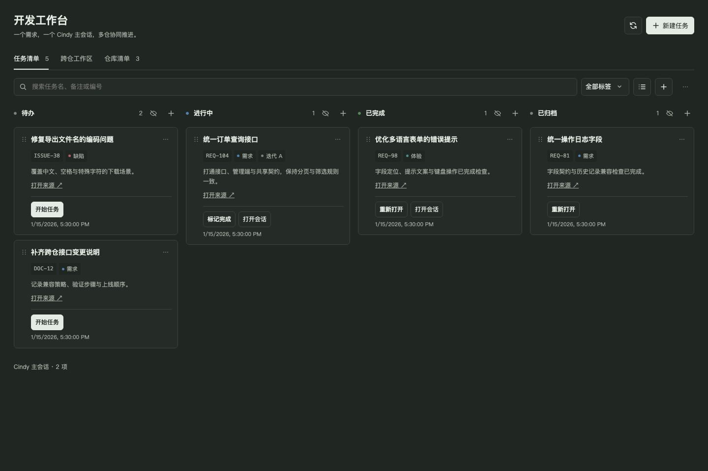

# Cindy Dev Workbench

[简体中文](README.md) · [Source import format](docs/sources.md) · [Architecture](docs/architecture.md) · [Script interface](docs/automation.md)

A Cindy development workbench for requirements from any source. Organize each requirement in one main session and track branches, worktrees, PR/MRs and validation across multiple repositories.

Requirements can come from tickets, documents, discussions or manual notes. Import a task list, create a development session, associate repositories, and track implementation and merge progress.

## Screenshots

These images render the actual plugin UI with fictional tasks, repositories and pull requests.

### Task board



### Cross-repository workspace



### Dark mode



## Features

- Board/list views, labels, status columns, pinning, ordering and drag interactions.
- Source-neutral task imports, deduplicated by source ID and external task ID, preserving manual edits and session links.
- Empty-session creation followed by separately confirmed development instructions. Unknown send results are never replayed automatically.
- Independent branch, worktree, PR/MR and validation records for each repository in a requirement.
- Merge progress, review filters, folding, hidden-repository recovery and diff inspection.
- Explicit repository selection and bounded discovery under a user-selected directory.
- Restricted local script interface for imports and inspections without starting a model.
- Preview-only cleanup. Removing workbench records does not delete actual sessions or worktrees.

## Import tasks

Use **导入任务** (Import tasks) to paste a task-list JSON, or call `import_source_items` in the `sources` tool category from a Cindy session. See [the input format](docs/sources.md).

```json
{
  "source": {"id": "work-items", "name": "Work items"},
  "items": [
    {"id": "104", "ref": "REQ-104", "title": "Unify the order query API", "labels": ["Requirement"]}
  ]
}
```

External tools handle authorized retrieval and source authentication. Importing only adds task records; it does not create sessions or start development.

## Development

Requires Node.js 22+, Git and `zip` / `unzip`. No third-party npm runtime dependencies. PR/MR inspection uses authenticated `gh` / `glab`; unknown query results are never treated as merged.

```sh
npm ci
npm run check
npm test
npm run pack
```

Output: `dist/cindy-dev-workbench-<version>.cindy`, with `ghost.json` at ZIP root. Use Cindy's `ghost_forge_pack` on `dist/plugin` for additional host validation. `npm run preview` serves a fictional-data preview on a loopback address printed in the terminal; it does not access real host sessions, repositories or business systems.

## Installation and data

Import the `.cindy` package through Cindy's local installation flow. Keep the same plugin ID and installation source for in-place updates; switching sources may isolate existing data. Source pushes do not install or deploy the plugin. The script interface uses a resident sandbox and Node process while Cindy is running; the plugin reports changes and business failures through its notification capability.

The **Verify plugin** workflow checks source, tests and packaging, with test artifacts retained for seven days. It does not publish to the marketplace. Permission and data boundaries are detailed in the Chinese README. Unknown create/send results must be reconciled rather than replayed. Imports validate the whole batch before writing; missing entries are not deleted.

This independent third-party plugin follows Cindy's manifest/archive contract. Manifest v3 and the existing minimum Cindy version `0.1.130` are retained. Fixture tests and screenshots do not prove all native host behavior or gesture support.

Licensed under [Apache-2.0](LICENSE); pinned upstream validator attribution is retained in [NOTICE](NOTICE).
