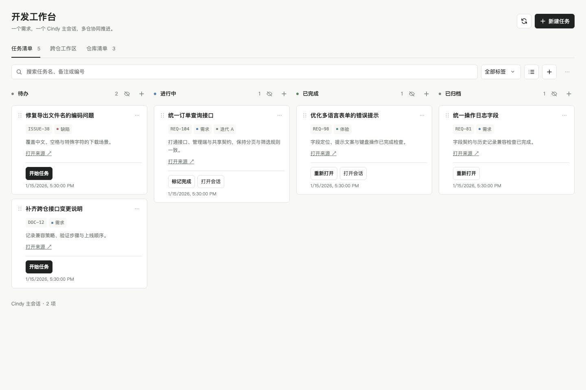
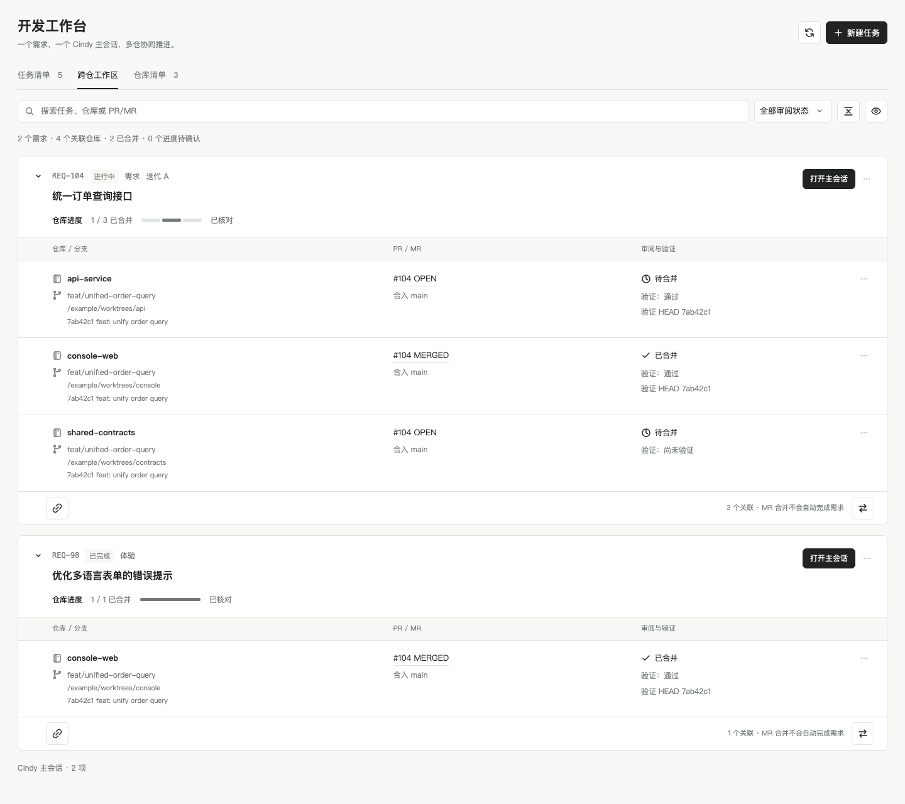
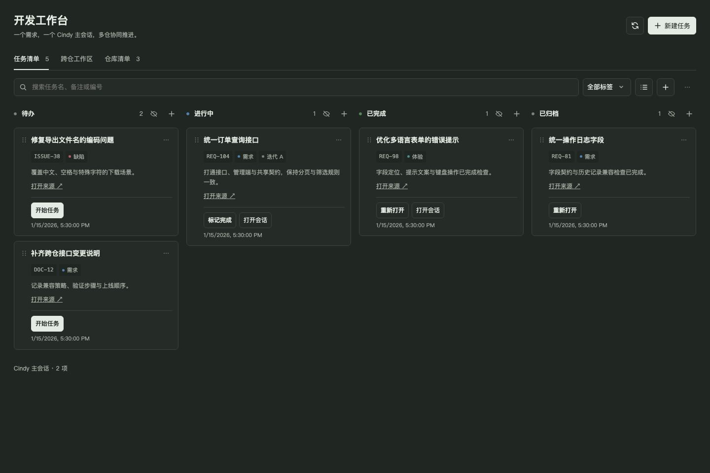

# 开发工作台 · Cindy Dev Workbench

[English](README.en.md) · [来源接入](docs/sources.md) · [贡献指南](CONTRIBUTING.md) · [架构](docs/architecture.md) · [脚本接口](docs/automation.md)

面向任意需求来源的 Cindy 开发工作台。一个需求对应一个主会话，统一管理多个仓库的分支、worktree、PR/MR 和验证记录。

需求可以来自工单、文档、讨论或人工整理。将任务导入工作台后，创建开发会话、关联仓库，再跟踪各仓库的实现与合并进度。

## 界面预览

截图由实际插件页面渲染，全部使用虚构任务、仓库和合并请求。

### 任务看板



### 跨仓工作区



### 暗色界面



## 功能

- 任务看板与列表，标签、状态列、置顶、排序和拖拽。
- 导入任意来源的任务清单，以来源 ID 和外部任务 ID 联合去重，保留手工编辑与会话关联。
- 从任务创建空会话，确认开发指令后开始开发；发送结果未知时保留回执，避免重放。
- 每个主会话可关联多个仓库，各自保存分支、worktree、PR/MR、验证状态及提交。
- 跨仓合并进度、审阅筛选、折叠、隐藏恢复与差异查看。
- 用户手动选择仓库或明确选择上级目录后检测导入，不在后台扫描磁盘。
- 受限本机脚本接口，可在不启动模型的情况下导入任务和执行巡检。
- 清理仅预演；移除工作台记录不会删除真实会话、仓库或 worktree。

## 导入任务

点击「导入任务」，粘贴统一格式的 JSON；也可由 Cindy 会话调用 `sources` 类目的 `import_source_items` 工具。详见[来源接入格式](docs/sources.md)。

```json
{
  "source": {"id": "work-items", "name": "需求清单"},
  "items": [
    {"id": "104", "ref": "REQ-104", "title": "统一订单查询接口", "labels": ["需求"]}
  ]
}
```

工作台接收已授权获取的数据，来源系统的查询和认证由外部工具完成。导入只写入任务清单，不会自动创建会话或启动开发。

## 开发与打包

需要 Node.js 22+、Git，以及 `zip` / `unzip`。无第三方 npm 运行依赖。GitHub PR / GitLab MR 查询分别依赖已登录的 `gh` / `glab`；查询未知不会当作已合并。

```sh
npm ci
npm run check
npm test
npm run pack
```

输出为 `dist/cindy-dev-workbench-<version>.cindy`，安装包根目录包含 `ghost.json`。也可在 Cindy 中对 `dist/plugin` 调用 `ghost_forge_pack`，进行当前宿主的 Forge 校验。

运行 `npm run preview` 可打开使用虚构数据的隔离预览，终端会输出本机地址。预览不接入真实 Cindy 会话、仓库或业务系统。

## 安装、更新与数据

在 Cindy 本地插件安装入口导入 `.cindy`。已有本地开发副本保留 ID `cindy-dev-workbench` 和原安装来源，按原位更新流程操作。更换市场或组织来源可能隔离账号和数据。

仓库 push 不会自动安装。Actions 的 **Verify plugin** 在 push / PR 时检查并提供保留 7 天的测试包，未配置市场发布或自动部署。

权限用途：`fs` 用于插件数据目录双槽持久化及回读备份，`pick` 用于明确选目录，`node` 用于只读仓库查询及编辑器打开，`agent.tasks` / `agent.targets` 用于会话核验、创建、导航与确认后的指令发送。`mainView` / `taskView` 展示工作台。脚本接口使用常驻电子脑和 Node 进程随 Cindy 启停，`notify` 仅在有变化或业务失败时显示工作台轻提示。

未知创建或发送结果须核对原幂等请求，不直接重试。导入前整批校验，缺席条目不自动删除。运行数据保留在 Cindy 插件数据目录，不属于源码。

## 规范与验证

按 [Cindy 插件目录与打包规范](https://github.com/makecindy/cindy-official-plugins/blob/bca1aa80988e31c702c6807145eab534aedc1ca8/CONTRIBUTING.zh-CN.md)组织独立第三方插件仓库。Manifest v3，最低 Cindy 版本沿用 `0.1.130`。

检查使用固定版本官方 Manifest 结构校验器、源代码检查、隔离测试和安装包清单验证。自动检查与隔离截图不能替代真实宿主 API 和原生手势验收。

[Apache-2.0](LICENSE)。官方校验器的来源与署名见 [NOTICE](NOTICE)。
